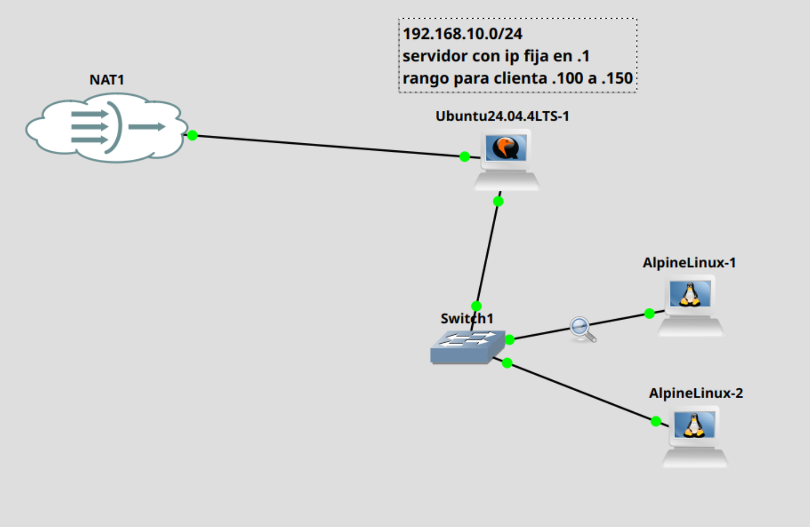

# DNS & DHCP

### Topología

1 Switch 

1 Ubuntu server

2 clientes (Alpine Linux)

1 Nat node



### Objetivos

Comprender ambos protocolos tanto dhcp y dns mediante el analisis de los paquetes de red

### DNS

consiste en dos paquetes: la query y la respuesta 

los paquetes estan construidos en capas: ethernet II, ipv4, UDP y finalmente el domain name system

### DHCP

Tenes 4 paquetes DORA: 

discover, offer, request y ack

discover y request salen de 0.0.0.0 a todos 255.255.255.255 porque el cliente todavía no tiene IP

# Paso a Paso

configurar IP fija en el servidor ubuntu 

en /etc/netplan 

```yaml
network:
    ethernets:
        ens4:
            dhcp4: true
        ens3:
            addresses: ["192.168.10.1/24"]    
    version: 2
```

descargar dnsmasq con 

`sudo apt install dnsmasq`

editar la configuracion en /etc/dnsmasq.d/lab.conf

```ini
interface=ens3
bind-interfaces 
dhcp-range=192.168.10.100,192.168.10.150,12h
dhcp-option=6,192.168.10.1
address=/servidor.lab/192.168.10.1
```

iniciar el servicio con `sudo systemctl restart dnsmasq`

Ahora debemos de empezar a capturar paquetes entre el switch y el cliente (Alpine Linux) 

En el cliente desplegados que aun no cuentan con IP se puede solicitar la IP al ubuntu server con    `udhcpc -i eth0`

En cuanto al protocolo dns podemos solicitar la IP con un hostname de la siguiente manera `nslookup servidor.lab`

con estos pasos se finaliza el laboratorio con posterior analisis de los paquetes para entender mas a fondo de los protocolos

### Captura

La captura completa está en [dhcp-dns-lab.pcapng](dhcp-dns-lab.pcapng). Se puede abrir con Wireshark y filtrar con `dhcp` o `dns`.

# Extras

cuando esta probando que la configuracion de dnsmasq este correctamente realiza en cuanto al formato se debe de usar el siguiente comando que especifique cual es el archivo de configuracion en cuestion, caso contrario tomaría el que viene de ejemplo `dnsmasq -d --conf-file /etc/dnsmasq.d/lab.conf`


